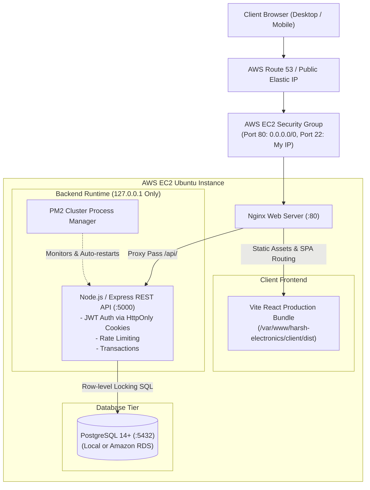

# Harsh Electronics - Production E-Commerce Platform

A complete, production-grade Electronics E-Commerce Web Application built for manual deployment onto an **AWS EC2 Ubuntu Server** with **Nginx Reverse Proxy**, **PM2 Process Manager**, and **PostgreSQL**.

---

## 1. System Architecture



---

## 2. Technology Stack

- **Frontend:** React 19, Vite, Tailwind CSS, React Router v7, Axios, Lucide React Icons.
- **Backend:** Node.js (LTS), Express.js, JWT (`jsonwebtoken`), `bcryptjs`, `cookie-parser`, `express-rate-limit`, Morgan.
- **Database:** PostgreSQL (with `pg` Pool, transactions, schema migrations, and seeds).
- **Web Server & Proxy:** Nginx with Gzip compression, rate limiting, and SPA client-side fallback.
- **Process Manager:** PM2 Cluster mode with auto-reboot persistence.
- **Target OS:** Ubuntu 22.04 / 24.04 LTS (AWS EC2).

---

## 3. Project Directory Structure

```text
harsh-electronics/
├── client/                     # Vite React Frontend
│   ├── public/
│   ├── src/
│   │   ├── components/         # Navbar, Footer, ProductCard, LoadingSkeleton
│   │   ├── context/            # AuthContext, CartContext, WishlistContext, ToastContext
│   │   ├── pages/              # Home, ProductList, ProductDetail, Cart, Checkout, OrderSuccess, Admin
│   │   ├── services/           # Axios API service (/api)
│   │   ├── utils/              # INR Currency formatting helpers
│   │   ├── App.jsx             # React Router routing & ProtectedRoute wrappers
│   │   └── main.jsx
│   ├── tailwind.config.js
│   ├── postcss.config.js
│   ├── vite.config.js          # Dev proxy forwarding /api to http://127.0.0.1:5000
│   └── package.json
├── server/                     # Express.js REST API & PostgreSQL Database
│   ├── migrations/             # 001_init_schema.sql (12 relational tables)
│   ├── seeds/                  # Seed logic
│   ├── src/
│   │   ├── config/             # Environment configuration (env.js)
│   │   ├── controllers/        # Auth, Product, Cart, Wishlist, Order, Review, Admin
│   │   ├── db/                 # Pool connection, migrate.js runner, seed.js
│   │   ├── middleware/         # JWT Auth, requireAdmin, Error handler, Rate limiters
│   │   ├── routes/             # REST route endpoints
│   │   └── app.js              # Express app entry & Health check (/api/health)
│   ├── tests/                  # Automated integration tests (Node.js test runner)
│   └── package.json
├── deploy/                     # AWS Production Deployment Configurations
│   ├── nginx.conf              # Reverse proxy configuration
│   └── ecosystem.config.cjs    # PM2 cluster configuration
├── scripts/
│   └── setup-ec2.sh            # One-click Ubuntu EC2 provisioning script
├── .env.example                # Template of environment variables
├── .gitignore
├── package.json                # Root monorepo scripts
└── README.md
```

---

## 4. Local Development Setup

### Prerequisites
1. **Node.js**: v20+ or v22+ LTS (`node -v`).
2. **PostgreSQL**: Installed and running on `localhost:5432`.

### Step 1: Install Dependencies
From the repository root:
```bash
# Install backend dependencies
cd server
npm install

# Install frontend dependencies
cd ../client
npm install
```

### Step 2: Configure Environment Variables
Copy `.env.example` to `server/.env`:
```bash
cd ../server
cp ../.env.example .env
```
Edit `server/.env` to provide your PostgreSQL password:
```env
PORT=5000
NODE_ENV=development
JWT_SECRET=your_super_secret_key_change_in_production
DB_HOST=127.0.0.1
DB_PORT=5432
DB_USER=postgres
DB_PASSWORD=your_postgres_password
DB_NAME=harsh_electronics
```

### Step 3: Initialize Local PostgreSQL Database
Open PostgreSQL terminal or pgAdmin:
```sql
CREATE DATABASE harsh_electronics;
```
Run migrations and sample seed data (over 30 flagship electronics):
```bash
# Run schema creation
npm run migrate

# Seed categories, brands, admin & sample products
npm run seed
```

### Step 4: Run Automated Tests
```bash
npm test
```
*Executes unit and integration test suites validating endpoints, inputs, and auth rules.*

### Step 5: Start Development Servers
In Terminal 1 (Backend API):
```bash
cd server
npm run dev
# Running on http://localhost:5000
```

In Terminal 2 (Frontend Client):
```bash
cd client
npm run dev
# Running on http://localhost:5173
```

Visit **http://localhost:5173** in your browser.

---

## 5. Pre-Configured Demo Accounts

For instant testing and grading:

| Role | Email | Password | Access Level |
|---|---|---|---|
| **Administrator** | `admin@harshelectronics.com` | `Admin@12345` | Full Admin Dashboard (`/admin`), product CRUD, order status |
| **Demo Customer** | `rajesh@example.com` | `Customer@12345` | Customer profile, shopping cart, checkout, saved wishlist |

*(You can also register any new customer account with full email validation).*

---

## 6. Manual AWS EC2 Deployment Guide (Step-by-Step)

### Step 1: Launch an AWS EC2 Instance
1. Go to **AWS Management Console** → **EC2** → **Launch Instance**.
2. **Name:** `harsh-electronics-prod`
3. **AMI:** `Ubuntu Server 24.04 LTS` (or `22.04 LTS`).
4. **Instance Type:** `t2.micro` or `t3.small` (Free tier eligible).
5. **Key Pair:** Select or create a `.pem` key pair (e.g., `harsh-ec2.pem`).
6. **Network & Security Group:**
   - **SSH (Port 22):** Source restricted to `My IP` (Critical for security).
   - **HTTP (Port 80):** Source `0.0.0.0/0` (Allow public web traffic).
   - **HTTPS (Port 443):** Source `0.0.0.0/0` (For TLS/SSL).
   - **DO NOT** open Port 5000 or Port 5432 to the public internet!

### Step 2: Connect via SSH
```bash
chmod 400 harsh-ec2.pem
ssh -i harsh-ec2.pem ubuntu@<YOUR_EC2_PUBLIC_IP>
```

### Step 3: Run Automated Server Provisioning
```bash
# Clone the repository
git clone https://github.com/<your-username>/harsh-electronics.git /var/www/harsh-electronics
cd /var/www/harsh-electronics

# Make setup script executable and run
chmod +x scripts/setup-ec2.sh
./scripts/setup-ec2.sh
```

### Step 4: Configure PostgreSQL on Ubuntu
```bash
sudo -u postgres psql
```
Inside the PostgreSQL shell:
```sql
CREATE DATABASE harsh_electronics;
CREATE USER harsh_app WITH ENCRYPTED PASSWORD 'StrongProductionPassword2026!';
GRANT ALL PRIVILEGES ON DATABASE harsh_electronics TO harsh_app;
-- For PostgreSQL 15+, grant schema usage:
\c harsh_electronics
GRANT ALL ON SCHEMA public TO harsh_app;
\q
```

### Step 5: Configure Backend & Seed Database
```bash
cd /var/www/harsh-electronics/server
cp ../.env.example .env

# Edit .env with your DB credentials
nano .env
```
Set in `.env`:
```env
PORT=5000
NODE_ENV=production
JWT_SECRET=super_long_random_openssl_secret_key_here
DB_HOST=127.0.0.1
DB_PORT=5432
DB_USER=harsh_app
DB_PASSWORD=StrongProductionPassword2026!
DB_NAME=harsh_electronics
```

Run migrations and seed:
```bash
npm run migrate
npm run seed
```

### Step 6: Start Backend Process via PM2
```bash
# Create log directory
sudo mkdir -p /var/log/harsh-electronics
sudo chown -R ubuntu:ubuntu /var/log/harsh-electronics

# Start application via PM2 cluster config
pm2 start /var/www/harsh-electronics/deploy/ecosystem.config.cjs --env production

# Save PM2 process list so it automatically restarts on system reboot
pm2 save
pm2 startup
# (Run the sudo env PATH=... command printed by PM2)
```

Verify backend health:
```bash
curl http://127.0.0.1:5000/api/health
```
Output:
```json
{"status":"OK","environment":"production","services":{"api":"healthy","database":"connected"}}
```

### Step 7: Build Frontend for Production
```bash
cd /var/www/harsh-electronics/client
npm install
npm run build
```
Verify the production bundle exists at `/var/www/harsh-electronics/client/dist`.

### Step 8: Configure Nginx Web Server
```bash
# Copy provided Nginx config
sudo cp /var/www/harsh-electronics/deploy/nginx.conf /etc/nginx/sites-available/harsh-electronics

# Enable site via symbolic link
sudo ln -sf /etc/nginx/sites-available/harsh-electronics /etc/nginx/sites-enabled/

# Remove default Nginx welcome page
sudo rm -f /etc/nginx/sites-enabled/default

# Test Nginx syntax
sudo nginx -t

# Reload Nginx
sudo systemctl reload nginx
```

Now open `http://<YOUR_EC2_PUBLIC_IP>` in your web browser!

---

## 7. Cloud Engineering Troubleshooting Guide (15 Real-World Scenarios)

### Scenario 1: EC2 Public IP Does Not Open in Browser
- **Symptoms:** Browser shows `ERR_CONNECTION_TIMED_OUT`.
- **Root Cause:** AWS Security Group is missing inbound rule for port 80, or EC2 instance has stopped.
- **Diagnosis Command:**
  ```bash
  # Check if port 80 is listening on the server:
  sudo ss -lntp | grep :80
  ```
- **Fix:** In AWS Console → EC2 → Security Groups → Inbound Rules → Add `HTTP (80)` from `0.0.0.0/0`.

### Scenario 2: Nginx Returns 403 Forbidden
- **Symptoms:** Nginx error page showing `403 Forbidden`.
- **Root Cause:** File permissions on `/var/www/harsh-electronics/client/dist` prevent the `www-data` user from reading files.
- **Diagnosis Command:**
  ```bash
  sudo tail -n 20 /var/log/nginx/error.log
  ```
- **Fix:**
  ```bash
  sudo chmod -R 755 /var/www/harsh-electronics/client/dist
  sudo chown -R www-data:www-data /var/www/harsh-electronics/client/dist
  ```

### Scenario 3: Nginx Returns 404 Not Found on Page Refresh
- **Symptoms:** Home page works, but refreshing `/products` or `/dashboard` gives 404.
- **Root Cause:** Nginx is trying to find a directory named `/products` on disk instead of delegating to `index.html`.
- **Fix:** Ensure `try_files $uri $uri/ /index.html;` exists in `location /` block of `nginx.conf`.

### Scenario 4: Nginx Returns 502 Bad Gateway
- **Symptoms:** 502 Bad Gateway when loading products or making API calls.
- **Root Cause:** Node.js backend is stopped, crashed, or not bound to port 5000.
- **Diagnosis Commands:**
  ```bash
  pm2 status
  pm2 logs harsh-electronics-api --lines 30
  sudo ss -lntp | grep :5000
  ```
- **Fix:** Check PM2 logs for database connection errors or syntax crashes, fix `.env`, and run `pm2 restart all`.

### Scenario 5: Nginx Returns 504 Gateway Timeout
- **Symptoms:** Page hangs for 60 seconds before showing 504 Gateway Timeout.
- **Root Cause:** PostgreSQL query is hanging, deadlock occurred, or upstream Node server is locked in an infinite synchronous loop.
- **Diagnosis Commands:**
  ```bash
  sudo tail -n 20 /var/log/nginx/error.log
  sudo -u postgres psql -c "SELECT pid, query, state, age(clock_timestamp(), query_start) FROM pg_stat_activity WHERE state != 'idle';"
  ```
- **Fix:** Kill long-running blocking query (`SELECT pg_terminate_backend(pid);`) or restart Node API.

### Scenario 6: Node.js Backend Crashes on Startup
- **Symptoms:** PM2 status shows restart counter incrementing rapidly (`errored` / `restart: 15`).
- **Root Cause:** Missing `.env` file, syntax error in config, or database credentials rejected.
- **Diagnosis Command:**
  ```bash
  pm2 logs --err --lines 50
  ```
- **Fix:** Correct syntax in `server/.env` and verify database host/port.

### Scenario 7: PM2 Process is Stopped
- **Symptoms:** `pm2 status` shows `stopped` or process missing from list.
- **Fix:**
  ```bash
  pm2 start /var/www/harsh-electronics/deploy/ecosystem.config.cjs --env production
  pm2 save
  ```

### Scenario 8: PostgreSQL Connection Fails (`ECONNREFUSED 127.0.0.1:5432`)
- **Symptoms:** `/api/health` reports `database: disconnected`.
- **Root Cause:** PostgreSQL service is down or not listening on port 5432.
- **Diagnosis Commands:**
  ```bash
  sudo systemctl status postgresql
  sudo ss -lntp | grep :5432
  ```
- **Fix:**
  ```bash
  sudo systemctl restart postgresql
  ```

### Scenario 9: Frontend Works but API Calls Fail with "Network Error"
- **Symptoms:** Website loads, but product lists show loading indefinitely or error banner.
- **Root Cause:** Hardcoded `http://localhost:5000` in client API calls instead of relative `/api`.
- **Fix:** Ensure Axios uses `baseURL: '/api'`. Nginx will forward `/api/` to upstream backend.

### Scenario 10: Product Data is Missing
- **Symptoms:** Products list shows "0 products found".
- **Diagnosis Command:**
  ```bash
  sudo -u postgres psql -d harsh_electronics -c "SELECT count(*) FROM products;"
  ```
- **Fix:** Run seed script:
  ```bash
  cd /var/www/harsh-electronics/server
  npm run seed
  ```

### Scenario 11: Login Fails Due to "Password Hashing Mismatch"
- **Symptoms:** Admin or customer credentials rejected.
- **Fix:** Re-run seed script to re-hash bcrypt passwords with 10 salt rounds:
  ```bash
  npm run seed
  ```

### Scenario 12: CORS Errors Occur in Browser Console
- **Symptoms:** `Access to fetch at ... has been blocked by CORS policy`.
- **Root Cause:** Request is bypassing Nginx and hitting an unauthorized domain.
- **Fix:** When accessing through Nginx, all requests are same-origin (`/api`), preventing CORS issues. For direct cross-domain calls, add domain to `allowedOrigins` in `server/src/app.js`.

### Scenario 13: Website Works Locally but Not on EC2
- **Symptoms:** Local works fine; EC2 shows blanks or errors.
- **Root Cause:** Hardcoded Windows file paths (`D:\...`) or missing environment variables.
- **Fix:** Use Node `path.resolve` and verify `server/.env` is configured for Linux environment.

### Scenario 14: Website Breaks After Server Reboot
- **Symptoms:** EC2 reboot causes 502 Bad Gateway.
- **Root Cause:** PM2 startup hook was not registered.
- **Fix:**
  ```bash
  pm2 startup
  pm2 save
  sudo systemctl enable nginx
  sudo systemctl enable postgresql
  ```

### Scenario 15: Port 5000 is Accidentally Exposed Publicly
- **Symptoms:** Security audit flags open port 5000.
- **Root Cause:** Backend bound to `0.0.0.0:5000` and Security Group allows port 5000.
- **Diagnosis Command:**
  ```bash
  sudo ss -lntp | grep :5000
  ```
- **Fix:**
  1. In `server/src/app.js`, verify bind address is `127.0.0.1` in production:
     `app.listen(config.port, '127.0.0.1', ...)`
  2. Block external traffic in UFW: `sudo ufw deny 5000`.
  3. Remove port 5000 from EC2 Inbound Security Group rules.

---

## 8. Transitioning to Amazon RDS PostgreSQL

When scaling beyond a single instance:
1. Launch an **Amazon RDS PostgreSQL** instance in the same AWS Region and VPC.
2. In the RDS Security Group, allow inbound **Port 5432** ONLY from the EC2 instance Security Group.
3. Update `server/.env`:
   ```env
   DB_HOST=harsh-rds.c12345.ap-south-1.rds.amazonaws.com
   DB_USER=rds_master_user
   DB_PASSWORD=YourRDSMasterPassword
   DB_NAME=harsh_electronics
   DB_SSL=true
   ```
4. Run migrations from EC2:
   ```bash
   npm run migrate
   npm run seed
   ```
5. Restart PM2: `pm2 restart all`.

---

## 9. Cleanup Instructions

To avoid unnecessary AWS charges:
1. In the **AWS EC2 Console**, select `harsh-electronics-prod` → **Instance State** → **Terminate Instance**.
2. Delete allocated **Elastic IPs** if any.
3. If using RDS, terminate the database instance (disable final snapshot if not needed).
